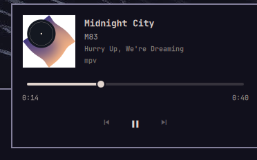

# Vinyl

A music player for the Omarchy bar. Album art and the now playing track sit in the
top bar, and a click opens a panel with cover art, a seek bar and transport
controls, driven by MPRIS.

Vinyl is free and open source software under the MIT license. It is a single
self contained plugin with no dependencies beyond Omarchy itself, and it follows
whatever theme is active.




## Features

- Album art thumbnail and scrolling `title · artist` in the bar, next to the clock
- Panel with large cover art, title, artist, album and the app playing
- Seek bar with elapsed and remaining time, live while the track plays
- Previous, play/pause and next controls, dimmed when the player cannot do them
- Player picker when several MPRIS apps are running
- Keyboard driven: space, arrows, `n` and `p`
- Follows the Omarchy theme tokens, so colours, borders, radii, fonts and the
  animation toggle match whatever theme is active, in every bar position
- Translated for every Omarchy language through `i18n/` catalogs

## Requirements

- Omarchy 4.5 or newer, with the Quickshell based shell and its plugin support
- Any MPRIS capable player: Spotify, Firefox, Chromium, mpv, VLC, cliamp, cmus

## Install

One command, from a terminal on your Omarchy machine:

```bash
omarchy plugin add https://github.com/CAPY000/omarchy-vinyl.git --enable
```

Or install it first and enable it later:

```bash
omarchy plugin add https://github.com/CAPY000/omarchy-vinyl.git
omarchy plugin enable vinyl.player
```

The plugin installs as `vinyl.player`. Put it where you want it in the bar:

```bash
omarchy bar move vinyl.player --section centerEnd
```

It also works in `left`, `centerBegin`, `center`, `right` and the tray drawer, on
top, bottom and vertical bars.

With no track playing the widget hides itself, so an idle bar stays clean.

## Using it

| Where | Action | Result |
| --- | --- | --- |
| Bar | left click | open the panel |
| Bar | right click | play or pause |
| Bar | middle click | next track |
| Bar | scroll up / down | previous / next track |
| Bar | hover | tooltip with the current track |
| Panel | seek bar | drag to jump, click to seek |
| Panel | cover + titles | cover art, title, artist, album and player name |
| Panel | player rows | switch which app the widget follows |

Panel keys:

| Key | Action |
| --- | --- |
| `Space` | play or pause |
| `Left` / `Right` | seek back or forward 5 seconds |
| `Up` / `Down` | previous or next track |
| `n` / `p` | next or previous track |
| `Esc` | close the panel |
| `Tab` | switch to the next bar panel |

## Settings

The label width in the bar is configurable per widget, in
`~/.config/omarchy/shell.json`:

```json
{
  "bar": {
    "layout": {
      "centerEnd": [
        { "id": "vinyl.player", "maxLabelWidth": 220 }
      ]
    }
  }
}
```

The file reloads on save. Long titles scroll instead of being cut, and they stop
scrolling while the panel is open.

## Update and remove

```bash
omarchy plugin update vinyl.player
omarchy plugin disable vinyl.player
omarchy plugin remove vinyl.player
```

## How it works

Vinyl talks to MPRIS directly through `Quickshell.Services.Mpris`, so it does not
depend on any other plugin or on `playerctl`. It reads the track metadata, the
playback state and the position, and only shows the capabilities the player
reports. The bar widget extends Omarchy's `Panel` and `KeyboardPanel` kit, so the
popup grows out of the icon, closes on an outside click, hands over to the
neighbouring panels and follows reduced motion settings the way the built-in
widgets do.

```
manifest.json    plugin manifest, bar widget declaration and settings schema
MusicBar.qml     bar widget and popup panel
Model.js         MPRIS player selection, ordering and time formatting
i18n/            string catalogs, one file per Omarchy language code
docs/            the screenshots used above
```

## Translations

`i18n/en.json` and `i18n/fr.json` ship with the plugin. Copy one and rename it to
the Omarchy language code (`de.json`, `pt-BR.json`, `da.json`, `ja.json`) to add a
language, then translate the values and keep the keys.

## Contributing

Bug reports and pull requests are welcome on GitHub. The plugin is plain QML, so
a change to `MusicBar.qml` or `Model.js` reloads as soon as the file is saved
while the shell runs, and `omarchy plugin validate .` checks the manifest before
anything is published.

## License

MIT. Free and open source, use it, fork it, ship it in your own theme.
